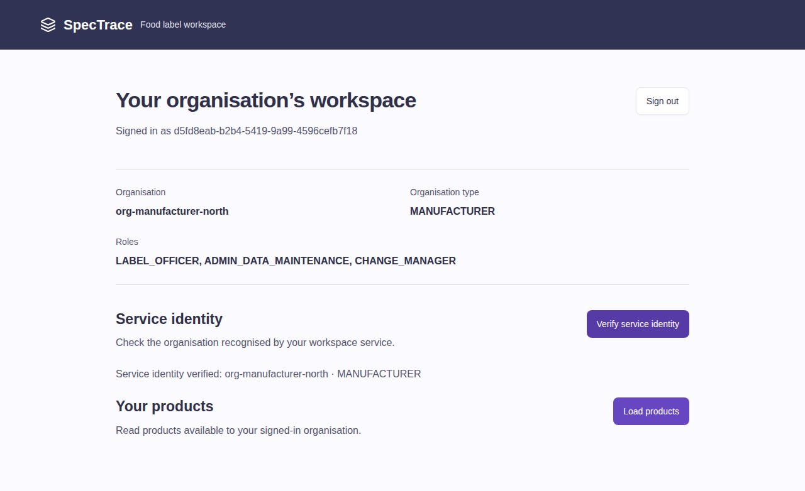

# G1-M3 readiness and current release — 13 October 2026

Owner: M3 Xu Feiyang (`codingbychatgpt`). Scope: STCN-51/52/53 under STCN-8.
This records an immutable tested release and the accepted-main audit, independently
of subsequent test/documentation commits. Final human acceptance remains with M4.

## Accepted main cannot yet complete G1-M3

After a fresh `git fetch origin`, main is
`8316071699652d723e8a675d93b0011a17d04de5`. The following findings come from that
exact tree, not from the working XFY branch:

| Requirement | Exact-main finding | Source/delivery needed |
|---|---|---|
| Runnable M3 Gateway | `platform/gateway` is absent; the generic Helm gateway values only declare a service name and empty ingress selectors | M3 PR37 |
| Code+PKCE reference consumer | `frontend/src/auth` is absent; App renders the baseline Shell with browser routing | M3 PR37 |
| Pages CI and project hash routing | `swe5001-m3.yml` and the sign-in/Pages profiles are absent; frontend has only the baseline `test:e2e` script | M3 PR37 |
| Public caller identity | Specification has no CallerClaimsController or `/api/specifications/caller-claims` endpoint | M4 PR47 |
| One issuer convention | Local Keycloak has no `KC_HTTP_RELATIVE_PATH`; Specification/Formulation use root `/realms/spectrace`; Compliance/Label Workflow have no shared issuer/JWKS bindings | M3 `/auth` configuration plus corrected M1 PR48 |
| Final shared security chain | Specification/Formulation retain their interim service-owned chains; Specification resolver checks null sub but not blank sub | M4 PR47 and corrected M1 PR48 |
| Live deployment acceptance | Source contains no evidence that this main is the public HTTPS Gateway/Keycloak/Pages deployment | M5 runtime and M4 acceptance |

Main already contains the accepted realm and starter from PR34/36, service source,
and generic service Helm templates. Those are useful prerequisites, but they do
not supply the missing M3 source, public caller endpoint, final configuration or
an actual deployed URL. Main is not described as having no security support.

Reproduce the source checks without switching branches:

```powershell
git rev-parse origin/main
git ls-tree -r --name-only origin/main -- platform/gateway frontend/src/auth .github/workflows/swe5001-m3.yml
git show origin/main:frontend/src/App.tsx
git show origin/main:deploy/local/compose.yaml
git show origin/main:services/specification/src/main/java/com/spectrace/specification/security/CallerResolver.java
```

At the same checkpoint PR37/47/48 are open and unmerged, at XFY `1da22c3`, M4
`0882375` and M1 `1b49279` respectively. The Pages API returns404 and only
`VITE_OIDC_AUDIENCE=spectrace-api` plus
`VITE_CALLER_CLAIMS_PATH=/api/specifications/caller-claims` are configured among
the required public variables. Actual Gateway origin/issuer and Pages enablement
are still missing. This API snapshot is not a substitute for runtime checks.

## Latest independently verified release at this checkpoint

Application: `1da22c3b04617b617091025d49fcbddc54b2366a`.
Real Specification provider: `088237586be335e85c91b368e1e5373854ace00b` (PR47).
Realm: accepted tracked PR34 source. Source PR37 still requires fresh owner
reviews; old M1/M4 approvals are dismissed, not approvals of this new head.

- [Trusted XFY push and image publication](https://github.com/hxj04121-lab/FoodLabelFlow-Microservices/actions/runs/38285572727)
- [M3 PR checks and real login](https://github.com/hxj04121-lab/FoodLabelFlow-Microservices/actions/runs/38285579471)
- [Full PR CI including security, containers and Sonar](https://github.com/hxj04121-lab/FoodLabelFlow-Microservices/actions/runs/38285579403)

All executed checks passed; Pages and PR image publication were conditionally
skipped. Independently run local checks: Gateway38, starter binding/security15,
native-sub2, provider caller/schema6; Compose models at8080/9080 and direct8180.
Both environment-name conventions bind actual starter SecurityProperties.
Compose model validation did not start containers.

Actual registry record: [release JSON](G1-M3-gateway-release-20261013.json).

```text
ghcr.io/hxj04121-lab/foodlabelflow-microservices/gateway:1da22c3b04617b617091025d49fcbddc54b2366a
ghcr.io/hxj04121-lab/foodlabelflow-microservices/gateway@sha256:1beb41fd360560bebdcffb84963aaeb400265297795206836eb7f4712ab630ac
```

The anonymous registry manifest digest was checked against the downloaded
publication artifact. Port8080, UID10001, readiness
`/actuator/health/readiness`, liveness `/actuator/health/liveness`.
Later commits must obtain their own publication result before claiming a new tag.

## Actual browser/service evidence

Chromium → real Gateway → Keycloak26.0.7 → real Specification0882375, with real
MySQL/RabbitMQ. No route/session mock or test whoami service. Anonymous Gateway
caller access is401. The service identity matches the token-derived UI identity:

| Field | Verified value |
|---|---|
| subject | `d5fd8eab-b2b4-5419-9a99-4596cefb7f18` (native sub) |
| org_id / org_type | `org-manufacturer-north` / `MANUFACTURER` |
| roles | `ADMIN_DATA_MAINTENANCE`, `CHANGE_MANAGER`, `LABEL_OFFICER` |
| caller path | `/api/specifications/caller-claims` |



The run's `m3-real-keycloak-evidence` includes redacted trace, claims and
service/infrastructure logs. This is CI-local real-component evidence: it does
not exercise the combined PR48 migration, all four services' business ownership,
AWS LB, deployed Pages or a stable staging window. Earlier 12 October evidence
using the removed whoami fixture remains historical, not current provider proof.

## Work M3 can complete without owner deployment

- Record this current evidence and correct live README/provider references.
- Provide the [deployment acceptance runbook](../G1-M3-staging-acceptance.md),
  exact public input contract and test-account/data requirements.
- Reuse the real login suite in a separate deployed profile, with strict input
  guards, no local server, no default live credentials and no live-secret trace.
- Preserve passing Gateway/login/Pages checks and retain owner source history.

Still needed: M1's corrected PR48 and merged-source regression; M4's fresh PR37
review, deployed realm/client and final acceptance; M5's reachable HTTPS/LB,
private JWKS/upstreams/network bindings and agreed test window; repository owner
Pages/main deployment settings. No peer PR is merged and no placeholder URL is
enabled by this delivery. Jira Done remains pending final acceptance.
