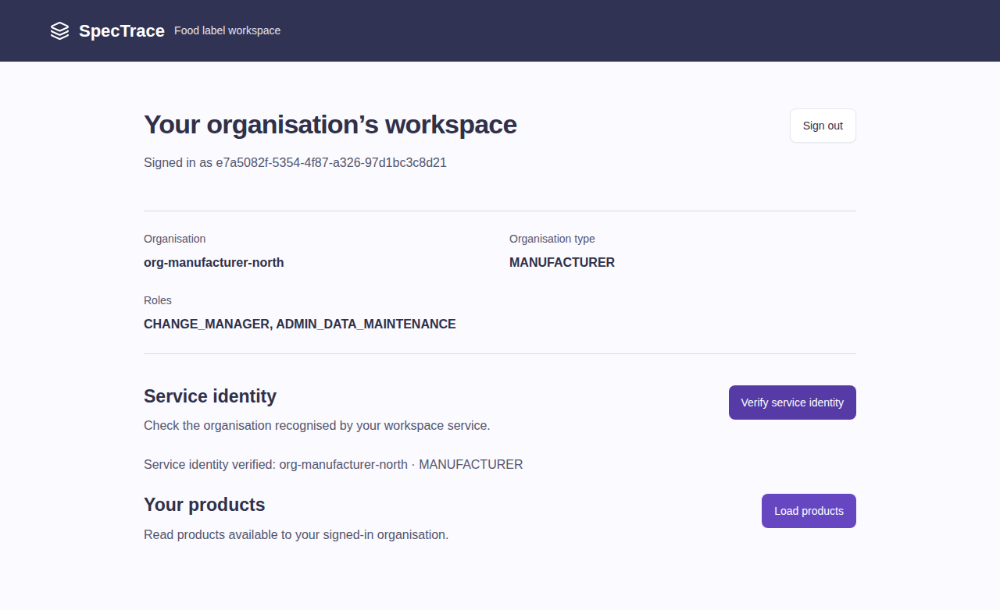

# G1-M3 actual image and real local login evidence

Application commit: `9653ee08708a72c42e568c4c48daeef53302482d`.
Date: 12 October 2026 (Asia/Singapore). Owner: M3 Xu Feiyang.

## Published Gateway

The [successful XFY run](https://github.com/hxj04121-lab/FoodLabelFlow-Microservices/actions/runs/38231526785)
verifies38 Gateway checks, local Compose bindings, Java21 image readiness/401,
HIGH/CRITICAL Trivy scanning, frontend checks and real browser identity before
publishing the same tested image. The registry-reported handoff is in
[gateway-release JSON](G1-M3-gateway-release-20261012.json):

```text
ghcr.io/hxj04121-lab/foodlabelflow-microservices/gateway:9653ee08708a72c42e568c4c48daeef53302482d
ghcr.io/hxj04121-lab/foodlabelflow-microservices/gateway@sha256:978b36420ba1ccd1ad53748c633069be1f3fa6a74b387007a2749661a1553faf
```

Application/container port8080; readiness `/actuator/health/readiness`;
liveness `/actuator/health/liveness`. Deployment still needs actual upstream,
issuer/JWKS/audience/CORS/role settings, network rules and authorized staging inputs.
This image's source commit is explicit; later documentation/frontend commits
must not be represented as this image's registry tag.

## Real browser identity chain

The same CI run boots real Keycloak26.0.7 and Gateway, then performs browser
authorization-code+PKCE login and calls a separate JVM service built with the
actual pinned M4 security starter. The service independently validates the
token before returning caller claims; the frontend confirms subject/org/type/
role-set equality. Anonymous Gateway access is401. Returned organisation is
`org-manufacturer-north`, type MANUFACTURER, roles ADMIN_DATA_MAINTENANCE and
CHANGE_MANAGER; subject is the native Keycloak user ID, not username.



Review artifacts in that run:

- `m3-real-keycloak-evidence`: redacted Playwright trace, verified claims and
  service/Gateway/Keycloak logs.
- `m3-gateway-release`: actual registry tag/digest JSON.
- `m3-gateway-evidence`, `m3-signin-evidence`: tests and protocol/Pages evidence.

Pinned integration candidates: M4 starter `9e1bc34`; M2-corrected realm
`7656780`. The caller `/api/labels/whoami` is a **test service endpoint**, not a
deployed Label Workflow contract. These real local components do not constitute
M4's acceptance of the realm candidate or the AWS browser→LB chain.

Actual testing found and fixed two Gateway interoperability defects: duplicate
edge/Keycloak CORS response headers, and opaque-Origin same-origin login-form
navigation caused by the IdP referrer policy. API/null-origin and script CORS
restrictions remain tested; only the session-bound IdP authenticate form is
delegated to Keycloak. No wildcard origin or credentialed API CORS grant is added.

## Still unverified

No AWS LB URL/service endpoint or approved staging window is supplied. The
repository has no configured public OIDC build variables; Pages job is skipped,
not deployed. Real public Gateway domain/certificate, provider-approved caller
path/DTO, exact Pages login/logout callback and runtime network bindings are
required before enabling production Pages. Final G1 and Jira Done require M4
acceptance. The image/local-login work is delivered without inventing these inputs.
